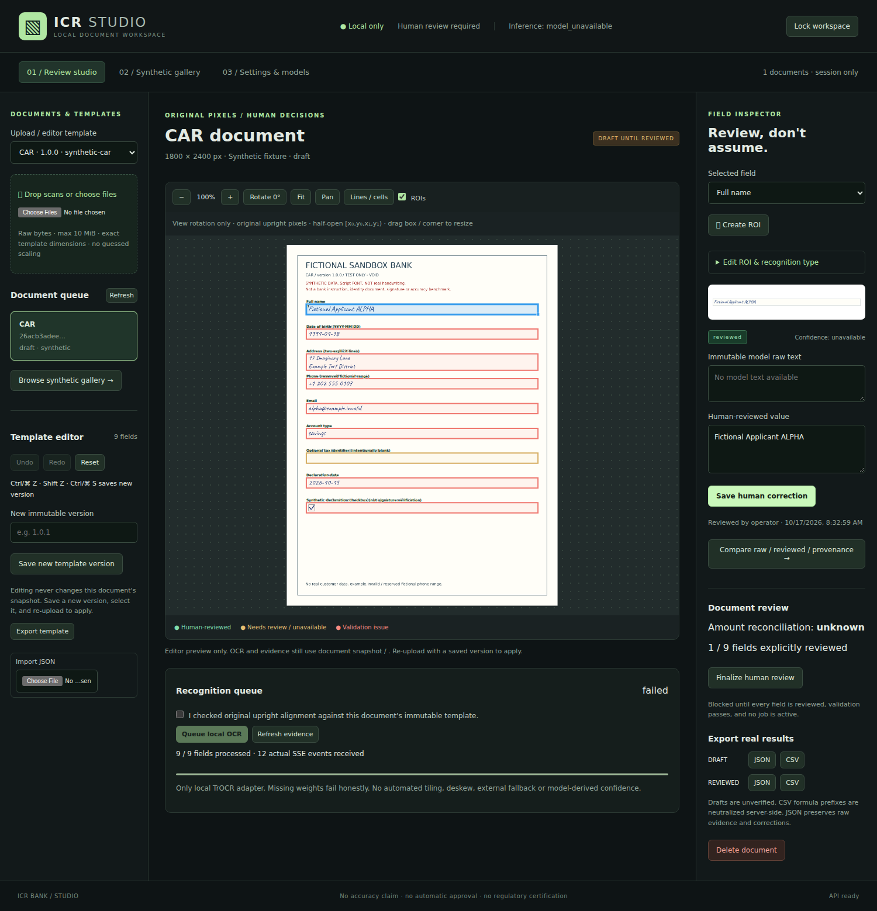
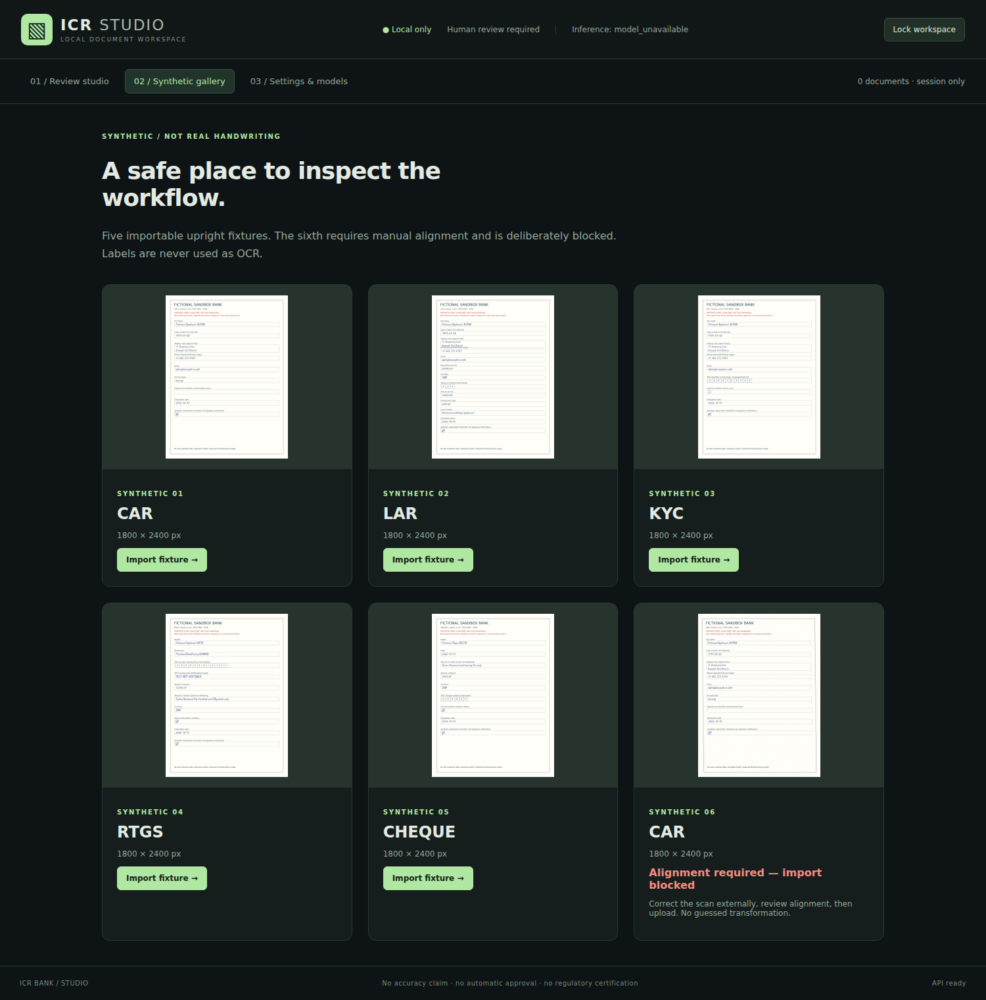
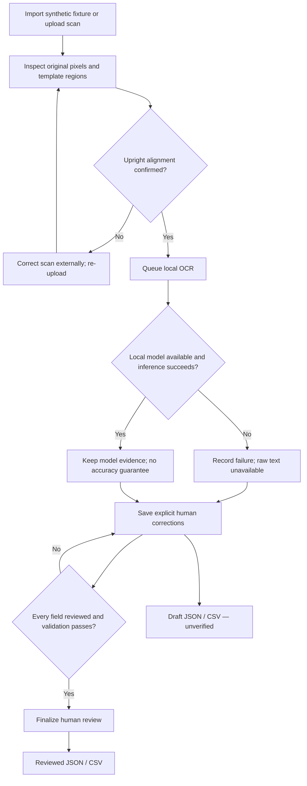
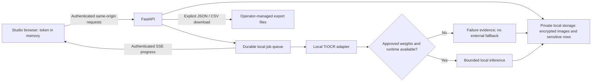

# ICR Studios · offline review + isolated web showcase

Inspect form scans, save human corrections and export traceable results in a local React + FastAPI workspace.

> **Manual-review prototype—not production-ready OCR.**
> Working review flow; no bundled weights, validated handwriting accuracy or calibrated confidence.
> [Implemented features and open gates →](docs/STATUS.md)

The Studio now uses a charcoal/obsidian, neon-lime industrial workspace. The
separate public showcase demonstrates the product direction and provides an
explicitly consented Hugging Face Space workflow; it is **not** part of the
offline application's runtime or build.

- **Offline Studio:** existing local review, templates, encrypted storage and
  local TrOCR adapter. No cloud inference or automatic model downloads.
- **Web showcase:** separate `studio/src/demo/` frontend and `web_demo/` gateway,
  with its own build and server. Uploads leave the device only after consent.
- **Requested model roadmap:** upstream projects identify
  [`lightonai/LightOnOCR-3-1B`](https://github.com/lightonai/LightOnOCR) (also
  0.8B/4B variants) and
  [`SeerRay-Lab/Xiaomi-OCR-0`](https://github.com/SeerRay-Lab/Xiaomi-OCR-0).
  They remain candidate adapters here. Weight revisions, licenses, compatible
  runtimes and evaluation must be established before local support is advertised.
  Plug-in installation, two-model benchmarking and packaged Windows/macOS/CLI
  downloads are not implemented by this UI redesign.



*Real running Studio, synthetic data only. The correction is human-entered—not an OCR prediction.*

[Start locally](#start-locally) · [Watch the workflow](#watch-the-workflow) · [What works?](#what-works-today) · [Operator guide](docs/STUDIO.md)

## Watch the workflow


**18-second capture sequence:** import → inspect → missing-model failure → correct → draft export.
Real browser actions and API responses; only pauses are condensed and captions added.
The downloaded JSON was checked: `review_state: draft`, `raw_text: null`, human correction preserved.

**Static alternative:** [Review workspace](docs/media/studio-review.png) · [Synthetic gallery](docs/media/studio-gallery.png).
Only one field is reviewed in this demo; it does **not** demonstrate final approval or successful OCR.

### Explore safely



| Import | Inspect & correct | Export |
| --- | --- | --- |
| Five importable fixtures; skewed sixth blocked | Original-pixel regions, crop evidence, saved human edits | Draft JSON/CSV; reviewed exports require final approval |
| Script-font simulations, **not real handwriting** | New template version? **Re-upload** to apply it | Raw evidence stays separate from corrections |

[Fixture provenance](data/samples/README.md) · [Template editing and review controls](docs/STUDIO.md)

## Document workflow



*Missing weights never produce invented text. Incomplete, invalid or stale review and amount mismatches block final approval.*

## Local processing boundary



*No outbound inference. Weights are provisioned separately, never downloaded at startup.
Browser memory and downloaded exports are outside encrypted storage.*

## What works today?

| Capability | Status |
| --- | --- |
| Authenticated Studio, encrypted local storage | **Implemented** — local operator tokens, not enterprise identity |
| PNG/JPEG and single-page PDF uploads | **Implemented** — max 10 MiB, exact template dimensions |
| Region editing, immutable templates, human corrections | **Implemented** — save new versions; re-upload to apply |
| Durable jobs, real SSE, draft/reviewed JSON & CSV | **Implemented** — explicit human approval; CSV formula-prefix protection |
| Local Microsoft TrOCR adapter | **Implemented adapter only** — real weights/inference unverified |
| Real handwriting dataset, CER/WER, confidence calibration | **Not established** — no accuracy or performance claims |
| Optional inference image, CUDA/MPS execution | **Unverified** — dependencies, approved weights and hardware required |
| Other requested models, OpenRouter, custom vLLM | **Unsupported** — no remote fallback |
| Automatic alignment, multipage PDF, signature/identity verification | **Not implemented** |
| Production banking compliance or automated approval | **Not claimed** |

[Detailed evidence and remaining gates](docs/STATUS.md) · [Evaluation methodology](docs/EVALUATION.md) · [Model/license evidence](docs/MODELS.md)

## Start locally

| Requirement | Version |
| --- | --- |
| OS | Linux / macOS |
| Python | 3.11+; previously tested with 3.12.3 |
| uv | 0.13.1 |
| Node / npm | 24.21.0 / 11+ |

Install uv through your approved package process (`python -m pip install uv==0.13.1`), then run from the repository root:

```sh
./scripts/start-local
```

1. Open **http://127.0.0.1:8000**.
2. Unlock using **only the operator bearer token** from the private `ICR_TOKENS` mapping in `var/secrets.env`—not the encryption key or whole mapping.
3. Open **Synthetic gallery**, import a fixture and follow the workflow above.

The helper installs locked dependencies, builds Studio and creates secrets once. **No model weights are fetched.**
Stop with **Ctrl-C**; reload or **Lock workspace** clears the in-memory browser token.

<details>
<summary>Manual startup / frontend development</summary>

```sh
uv sync --frozen
(cd studio && npm ci --ignore-scripts && npm run build)
uv run --frozen icr init-secrets   # once only; refuses to overwrite
. ./var/secrets.env
uv run --frozen icr serve
```

FastAPI serves Studio, API, images and events on the same origin; no CORS setup is needed.
For frontend development, keep the backend running and use `cd studio && npm run dev`.
Vite proxies to port 8000; never copy credentials into frontend environment files.

</details>

### Prefer Docker?

With Docker Engine + Compose v2:

```sh
./scripts/start-docker
```

Open **http://127.0.0.1:8000**; use the operator token from private `var/docker/secrets.env`.
The default nonroot CPU image supports manual review/API, **without Torch, Transformers or weights**.
Stop with `docker compose down`; private state is retained.

[CPU inference, NVIDIA opt-in, deployment and configuration →](docs/CONFIGURATION.md)

## Security essentials

- Keep `var/`, tokens and keys private and out of source control; never make their permissions world-readable.
- Use only synthetic data for public captures. These committed visuals contain fictional fixtures, no credentials or real banking data.
- Protect downloaded JSON/CSV separately: exports are **not encrypted by the application**.
- Keep the default loopback binding. External deployment needs reviewed HTTPS ingress and rate limiting.

[Security boundaries and incident handling](SECURITY.md) · [Deployment hardening](docs/CONFIGURATION.md#networktlsrate-limit-boundary)

## Verify it yourself

<details>
<summary>Existing lint, test, build and real-browser checks</summary>

```sh
(cd studio && npm ci --ignore-scripts && npm run lint && npm test && npm run build)
uv sync --frozen --extra test
uv run --frozen --extra test python -m unittest discover -s tests -v
docker compose config --quiet
docker build --target cpu -t icr-bank:studio .
```

For real browser smoke, start a **disposable synthetic-only** stack with private secrets and an installed Chromium:

```sh
# Defaults: URL http://127.0.0.1:8000, secret file var/studio-live/secrets.env
cd studio
CHROMIUM=/usr/bin/chromium npm run test:smoke
```

Override `ICR_SMOKE_URL` and repository-relative `ICR_SMOKE_SECRETS` if needed.
Smoke creates documents, template versions, corrections and runtime setting changes:
**never run it against production data**. Its screenshots/downloads remain in ignored `var/`.
The curated README media above was captured separately using only fictional fixtures; it is not a public dump of smoke artifacts.

</details>

## Reference shelf

| Need | Read |
| --- | --- |
| Implementation evidence & unfinished work | [Status](docs/STATUS.md) |
| Review, templates & settings | [Studio guide](docs/STUDIO.md) |
| Runtime, containers & configuration keys | [Deployment](docs/CONFIGURATION.md) · [Configuration reference](docs/CONFIG_REFERENCE.md) |
| Authentication, pixels & SSE contracts | [API](docs/API.md) |
| Architecture & model provenance | [Design](docs/DESIGN.md) · [Models](docs/MODELS.md) |
