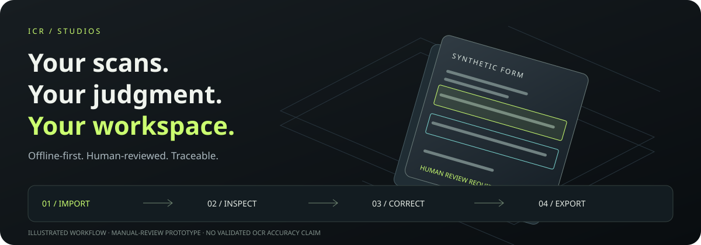
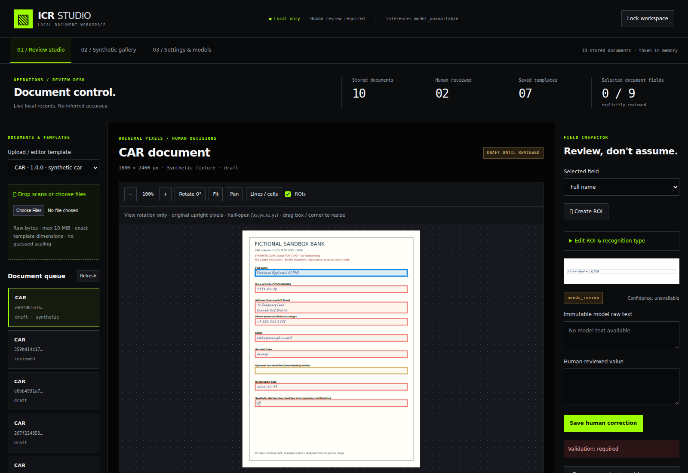
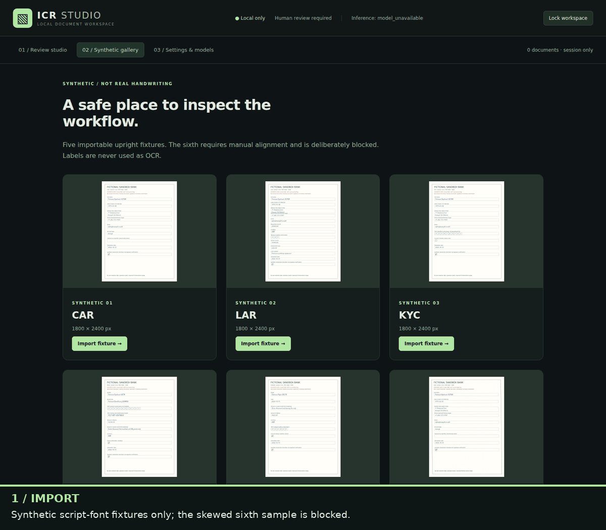

# ICR Studios

**From scanned forms to traceable, human-reviewed data. Locally.**

[](https://abhays02.github.io/ICR-Studios/)

[**Try live LightOnOCR ↗**](https://abhays02.github.io/ICR-Studios/#live-demo) · [**Watch the workflow**](#watch-the-real-recorded-workflow) · [**Start locally**](#start-locally) · [**Windows downloads**](https://github.com/abhays02/ICR-Studios/releases) · [**Read the guides**](#find-your-guide)

The site URL above is the default GitHub Pages target; it becomes available after
the publishing workflow succeeds and Pages is enabled. GitHub Markdown cannot
run interactive 3D scenes—follow the image to the separate animated experience.

> **Manual-review prototype—not production-ready OCR.**
> Working review flow; no bundled weights, validated handwriting accuracy or calibrated confidence.
> [Implemented features and open gates →](docs/STATUS.md)

## One project, three separate spaces

| Space | Purpose | Runs where? |
| --- | --- | --- |
| **Offline Studio** | Inspect scans, edit regions, save corrections, export results | Your computer; React + FastAPI, encrypted private storage |
| **Public landing & guides** | Recorded workflow, illustrated guides, opt-in external LightOnOCR Space | Static GitHub Pages; no local API or credentials; consented uploads go directly to Hugging Face |
| **Optional cloud showcase** | Synthetic illustration or explicitly consented provider extraction | Separate frontend + gateway; **not** included in offline Studio |

No cloud fallback or automatic weight downloads. The local TrOCR adapter still
needs separately approved weights and runtime verification.



*Real running Studio, synthetic data only. Metrics describe stored review state,
not model accuracy. No unavailable model output is fabricated.*

## Understand the workflow

| 01 · Import | 02 · Inspect | 03 · Correct | 04 · Export |
| --- | --- | --- | --- |
| PNG/JPEG or single-page PDF, max 10 MiB | Original pixels and template regions | Explicit human edits, separate from raw evidence | Draft JSON/CSV, or reviewed output after final approval |

Missing weights produce **failure evidence, never invented text**. Incomplete,
invalid or stale review blocks final approval. New template versions require
re-upload. Five fictional fixtures are importable; the skewed sixth is blocked.

[Operator walkthrough](docs/STUDIO.md) · [Architecture & local boundaries](docs/DESIGN.md) · [Fixture provenance](data/samples/README.md)

## Watch the real recorded workflow



18-second synthetic-only recording; pauses condensed and captions added.
Only one field is reviewed: this is **not** successful OCR or final approval.
The recording predates the visual redesign. The docs site offers optional
GIF playback with a still poster and stop control.

### Try real LightOnOCR on Hugging Face

[**Open the landing-page live demo**](https://abhays02.github.io/ICR-Studios/#live-demo)
or [visit LightOnAI's LightOnOCR 3 Space directly](https://huggingface.co/spaces/lightonai/LightOnOCR-3-Demo).
The landing page loads the external interactive Space only after consent.
Use synthetic documents only: uploads go to Hugging Face/LightOnAI, not to
your offline workspace. Availability, queues and provider retention are external;
this is not a bundled model or a claim of validated handwriting accuracy.

## Start locally

**Linux / macOS source:** Python 3.11+, uv 0.13.1, Node 24.21.0 / npm 11+.
From the repository root:

```sh
./scripts/start-local
```

1. Open **http://127.0.0.1:8000**.
2. Unlock using **only the operator bearer token** from the private `ICR_TOKENS` mapping in `var/secrets.env`—not the encryption key or whole mapping.
3. Open **Synthetic gallery**, import a fixture and follow the workflow above.

The helper installs locked dependencies, builds Studio and creates secrets once. **No model weights are fetched.**
Stop with **Ctrl-C**; reload or **Lock workspace** clears the in-memory browser token.

[Manual startup, Docker & deployment](docs/CONFIGURATION.md#source-runtime) ·
[Windows executable build & limitations](docs/CONFIGURATION.md#windows-release-build) ·
[Separate cloud showcase setup](studio/README.md#separate-public-demo)

Windows binaries are built and smoke-tested by the Windows release workflow.
Successful default-branch builds publish public **prereleases**, not production releases.
Download the ZIP and checksum from [Releases](https://github.com/abhays02/ICR-Studios/releases),
extract the whole folder, then double-click **RUN-STUDIO.cmd** and follow its
bundled **README.txt**. Do not run the bare `.exe` without its supporting files
or commands. Builds are **unsigned review prototypes** without OCR weights.

## What works today?

**Implemented:** authenticated review, encrypted local state, immutable templates,
durable jobs, progress events, human corrections, draft/reviewed JSON and CSV.

**Not established:** real handwriting accuracy, calibrated confidence, tested
model weights, CUDA/MPS execution, production banking compliance. Automatic
alignment, multipage PDF and signature/identity verification are not implemented.
Other model families remain candidates, not supported local adapters.

[Evidence & open gates](docs/STATUS.md) · [Models & licenses](docs/MODELS.md) · [Evaluation methodology](docs/EVALUATION.md)

## Security essentials

- Keep `var/`, tokens and keys private and out of source control; never make their permissions world-readable.
- Use only synthetic data for public captures. These committed visuals contain fictional fixtures, no credentials or real banking data.
- Protect downloaded JSON/CSV separately: exports are **not encrypted by the application**.
- Keep the default loopback binding. External deployment needs reviewed HTTPS ingress and rate limiting.

[Security boundaries and incident handling](SECURITY.md) · [Deployment hardening](docs/CONFIGURATION.md#networktlsrate-limit-boundary)

## Find your guide

| Need | Read |
| --- | --- |
| Use the workspace | [Studio operator guide](docs/STUDIO.md) |
| Install, publish or build Windows | [Runtime & deployment](docs/CONFIGURATION.md) |
| Develop or run the isolated showcase | [Frontend & showcase README](studio/README.md) |
| Implementation evidence & unfinished work | [Status](docs/STATUS.md) |
| Configuration keys | [Generated reference](docs/CONFIG_REFERENCE.md) |
| Authentication, pixels & SSE contracts | [API](docs/API.md) |
| Architecture & model provenance | [Design](docs/DESIGN.md) · [Models](docs/MODELS.md) |
| Evaluation & fixture rights | [Evaluation](docs/EVALUATION.md) · [Fixture README](data/samples/README.md) |
| Verify changes & protect data | [Contributor checks](studio/README.md#verification) · [Security policy](SECURITY.md) |
