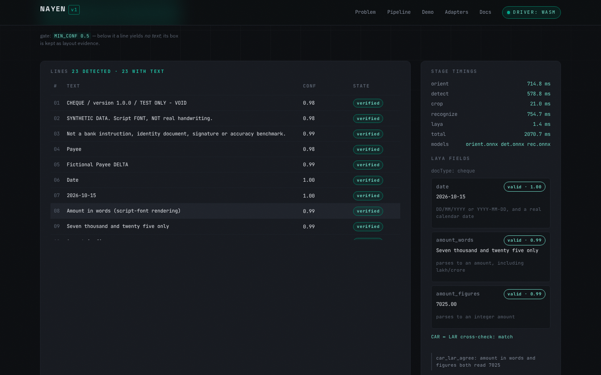

# ICR Studios — NAYEN v1

**A native Rust ICR engine for handwritten banking forms. Indra perceives, Laya
decides. It runs on your machine or in this browser tab — no server, no upload.**

<a href="docs/media/nayen-demo.mp4">
  
</a>

▶ [**Watch the 13-second recording**](docs/media/nayen-demo.mp4) — a real browser
session, recorded with `scripts/record_demo.mjs`. The engine reports itself live
(`DRIVER: WASM`) before anything runs; if it were absent the page would say so
instead of inventing output.

NAYEN v1 is **Indra** (orient → deskew → detect → crop → CTC recognize) and
**Laya** (script routing, confidence gating, field validation, CAR↔LAR
cross-check, review flags) integrated natively in one Rust core, `nayen-core`.
The same core drives two hosts through one contract:

| Host | Runtime | Where |
| --- | --- | --- |
| `nayen-cli` | ONNX Runtime (native, `load-dynamic`) | your machine |
| `nayen-wasm` | `onnxruntime-web`, single-threaded WASM | this browser tab |
| `nayen-wasm` in Studio | same seam, operator workspace | local review tool |

Neither host contains engine logic. The engine emits one `InferRequest` at a
time and waits to be handed the outputs back — which is what lets one codebase
run synchronously over `ort` and asynchronously over a JS `Promise`.

## What is actually measured

Not benchmarks, measurements — reproduced by `cargo test` and the golden
cross-checks in `crates/nayen-core/tests/golden_reference.rs`, which pin values
generated by the real `indra-ocr` Python package:

- **Port fidelity.** On a real handwritten page (900×1273): 21 lines detected by
  NAYEN v1, 21 by the reference Python pipeline, **identical text on all 21**,
  boxes within <1 px, mean CTC confidence within ±0.001 on 19 of 21.
- **Native speed.** 253 ms/page without deskew (≈3.95 pages/s single-threaded)
  against the reference Python's 356 ms on the same page. Deskew adds ~560 ms
  single-threaded; the reference parallelises it, we do not yet.
- **Browser.** ~2.0 s for an 1800 px page in headless Chromium, of which the
  detector and recognizer inferences dominate (see the recording's stage panel).
- **Size.** Engine WASM 472 KB. Weights: `det` 0.37 MB, `rec` 4.81 MB,
  `orient` 0.36 MB, `script` 0.19 MB. `order.onnx` is never fetched: reading
  order is computed deterministically.
- **Tests.** 115 in `nayen-core`, including 10 that replay the reference
  implementation's exact numbers (percentiles vs numpy, rotation vs
  `cv2.warpAffine` to ~1/255, decode/crop/CTC vs `indra-ocr`).

What is **not** established: calibrated confidence on your bank's forms,
multipage PDF, signature or identity verification, CUDA/MPS execution. The
shipped samples are synthetic CC0 renders in a script font — they prove the
pipeline runs, not that it reads handwriting like yours.
[Status & open gates →](docs/STATUS.md)

## README completion checklist (testable)

Treat this as the strict "done" gate for the promises in this README:

- [ ] **Core seam still shared across hosts.** `cargo test -p nayen-core`.
- [ ] **Native host path works.** `cargo run --release -p nayen-cli -- run data/samples/05-cheque.png`.
- [ ] **Browser host path builds and serves.** `./scripts/build_wasm && (cd web && npm run build)`.
- [ ] **Studio workspace verifies.** `(cd studio && npm run lint && npm test && npm run build)`.
- [ ] **Backend + Studio API contract verifies.** `uv sync --frozen --extra test && uv run --frozen --extra test python -m unittest discover -s tests -v`.
- [ ] **Cloud demo remains isolated from offline backend.** `uv run --frozen --extra test python -m unittest web_demo.test_app -v`.
- [ ] **No claim outruns evidence.** `docs/STATUS.md` and `docs/MODELS.md` still list open gates for unverified candidates.

When every line above is reproducibly green, the repository is "done" for the
current README claims. If any line fails, fix or narrow the corresponding claim
before marking completion.

## The adapter seam

`nayen-core` never calls a runtime. It asks for tensors:

```rust
pub trait Executor {
    fn run(&mut self, req: &InferRequest) -> Result<Vec<Tensor>, EngineError>;
    fn available(&self) -> &[ModelKind];
}
```

`nayen-cli` answers with `ort`; the browser answers with `onnxruntime-web`.
A C++, GGML/GGUF or vendor executor is another implementation of those two
methods — the engine, Laya and every host stay untouched. A model the host did
not load is skipped **with a note in `PageResult.notes`**, never substituted
with zeros: a placeholder that returns tensors would silently fabricate OCR.

## Try it

**Browser.** Drop any PNG/JPEG/WebP on the demo, or run one of the three shipped
forms. The image is decoded on a local canvas and never leaves the tab.

**Native.**

```sh
./scripts/fetch_indra_models --download --approve-license openrail   # weights -> var/models/indra-ocr
./scripts/fetch_ort                                                  # ONNX Runtime 1.20.1 -> var/onnxruntime
cargo run --release -p nayen-cli -- run data/samples/05-cheque.png
```

The CLI prints lines with boxes and confidence, Laya's validated fields, the
CAR↔LAR verdict and per-stage milliseconds. `--json` emits the whole
`PageResult`; `bench` reports median-run timings.

**Build the browser engine.**

```sh
./scripts/build_wasm     # cargo + wasm-bindgen -> web/public/wasm
cd web && npm run dev    # or: npm run build && npm run preview
```

**Studio (operator workspace).** `cd studio && npm run dev` — review queue,
corrections and exports over the same engine seam.

## Three surfaces, one theme

| Surface | What | Deployed where |
| --- | --- | --- |
| `web/` | Public immersive site + live demo | Vercel |
| `studio/` | Operator review workspace | Vercel |
| `docs/site/` | SDK + Studio documentation | GitHub Pages only |

All three consume the same design tokens from `packages/theme/tokens.css`
("Ink & Signal": graphite base, warm paper, teal/amber/fault encoding confidence
state), so the site, the tool and the Windows package read as one product.
The Windows build (`packaging/`) ships the same engine and theme.

## Honesty rules the code enforces

- A line below `MIN_CONF 0.5` yields **no text**; its box is kept as layout
  evidence and the suppression is reported.
- Laya validates against real rules (IFSC 11 chars, PAN 10, DD/MM/YYYY or
  ISO against the actual calendar, comb-box digit confusions O→0/I→1/S→5/B→8)
  and raises a fault when a value fails — including on its own shipped samples,
  one of which contains an impossible date on purpose.
- CAR↔LAR is only claimed as a mismatch when **both** amounts were actually
  read; otherwise the gap is reported.
- Every result carries `modelsUsed`, `notes`, `rotation` and stage timings, so
  a degraded run is visible rather than silent.
- The simulated driver exists so the UI is testable before weights arrive. It
  labels every line `[simulated]` and refuses to be mistaken for OCR.

## Repository map

| Path | Contents |
| --- | --- |
| `crates/nayen-core` | engine: image, skew, det, crop, ctc, vocab, laya, pipeline |
| `crates/nayen-cli` | native host + `ort` executor |
| `crates/nayen-wasm` | browser host facade (scratch-buffer tensor protocol) |
| `engine/src/types.ts` | the host contract, hand-maintained against the Rust |
| `web/` | public site + `WasmDriver` / `SimulatedDriver` |
| `studio/`, `backend/` | operator workspace and its local API |
| `docs/site/` | SDK + Studio docs (GitHub Pages) |
| `packages/theme/` | shared design tokens |
| `scripts/` | fetch weights, fetch ORT, build WASM, record the demo |

Models are `datalab-to/indra-ocr@v1.1.0`, OpenRAIL-licensed, fetched explicitly
and never vendored. [Model provenance →](docs/MODELS.md) ·
[Security boundaries →](SECURITY.md) · [Fixture rights →](data/samples/README.md)
