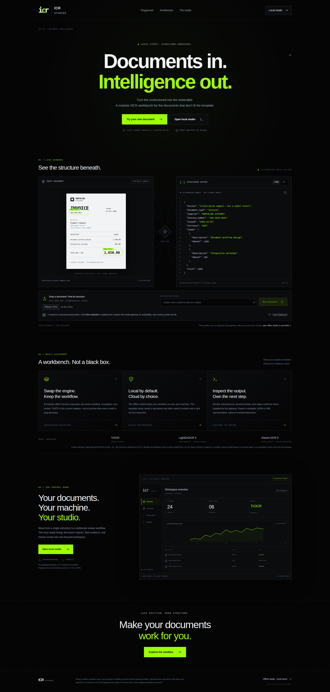

# ICR Studio

[Project overview](../README.md) · [Operator guide](../docs/STUDIO.md) · [Runtime & publishing](../docs/CONFIGURATION.md)

[Interactive version ↗](https://abhays02.github.io/ICR-Studios/studio-README.html)
(available after Pages publishes; GitHub READMEs remain static).

**Two frontend entry points. Two separate runtimes.**

| Build | What it contains | Where it runs |
| --- | --- | --- |
| `npm run build` → `dist/` | Offline review workspace | Same-origin FastAPI, port 8000 |
| `npm run build:demo` → `dist-demo/` | Optional consent-based cloud showcase | Separate `web_demo` gateway, port 8010 |

Public documentation is a **third, static build** under `docs/site/`; it connects
to neither runtime. Its interactive illustrations are not OCR predictions.

## Develop the offline workspace

React 19 / TypeScript 7 / Vite 8, scaffolded with `create-vite@9.2.1` and exact pins plus
npm lockfile. No CDN fonts, browser-persisted tokens or provider keys.

```sh
npm ci --ignore-scripts
npm run lint
npm test
npm run build
```

The production bundle is served same-origin by FastAPI; use the repository
`scripts/start-local`. Development `npm run dev` proxies API/health to port 8000.
`npm run test:smoke` exercises a real running stack with Chromium; see the root
verification section below for the private smoke-secret environment and artifact paths.

## Separate public demo

The cloud-consented landing page lives in `demo/` and `src/demo/`, not the
offline application's entry point. `npm run dev:demo` opens
`http://127.0.0.1:5174/demo/index.html` and proxies only `/demo-api` to the
separate gateway on port 8010. `npm run build:demo` writes `dist-demo/`;
`npm run build` still writes only the offline Studio to `dist/`.
Tailwind is enabled only in the demo build. Neither entry uses CDN assets.

The landing illustration is synthetic and its example output is not an OCR
prediction. Live uploads require explicit cloud consent and a configured Space.
No compatible public inference Space or real inference run has been verified.



### Run the gateway

Use synthetic documents only. The gateway never imports or mounts the offline
banking backend. With the existing Python dependencies installed, run from the
repository root:

```sh
(cd studio && npm ci --ignore-scripts && npm run build:demo)
WEB_DEMO_STATIC_DIR="$PWD/studio/dist-demo" \
  python -m uvicorn web_demo.app:app --host 127.0.0.1 --port 8010
```

Open **http://127.0.0.1:8010/demo/index.html**. Cloud extraction is disabled by
default; the illustrative sample remains usable. For frontend development,
run the gateway separately and use `npm run dev:demo` from `studio/`.

### Configure an explicitly consented provider

Set `WEB_DEMO_ENABLED=true` and `WEB_DEMO_MODELS_JSON` to an array of
operator-verified Space mappings: `id`, `label`, bare HTTPS `origin` ending in
`.hf.space`, exact single-segment `api_name`, `api_prefix` (default `/gradio_api`),
ordered `inputs`, and `text_pointer` (default `/0`). Catalog IDs are
`lightonocr-3` and `xiaomi-ocr-0`. Inside `inputs`, the literal `"$uploaded_file"`
is replaced recursively with Gradio `FileData`. Use the chosen Space's
**View API / Use via API** schema; there is no guessed endpoint or fallback.

`api_prefix` may be empty only for a verified older Space. `text_pointer` is a
JSON Pointer into the final Gradio output array. File-URL-only responses are
insufficient: the gateway does not fetch output URLs. A configured mapping
asserts operator verification, not a live health check.

Candidate upstream identities:
[`lightonai/LightOnOCR-3-1B`](https://github.com/lightonai/LightOnOCR) and
[`SeerRay-Lab/Xiaomi-OCR-0`](https://github.com/SeerRay-Lab/Xiaomi-OCR-0).
Xiaomi's linked Space is a project page, not evidence of an inference API.
Weight revisions, licenses, runtimes and evaluation remain open gates for local
support. Plug-in installation and two-model benchmarking are not implemented.

| Server-only setting | Default |
| --- | --- |
| `WEB_DEMO_HF_TOKEN` | Unset; optional provider credential, never a Vite/browser variable |
| `WEB_DEMO_CONCURRENCY` | 2 active requests (range 1–8) |
| `WEB_DEMO_DEADLINE_SECONDS` | 90 seconds (range 1–180) |
| `WEB_DEMO_STATIC_DIR` | Unset; absolute path to the separate `studio/dist-demo` build |

The browser sends raw PNG/JPEG/PDF bytes to `/demo-api/extract` only after
explicit consent, with `X-Model-Id` and `X-Cloud-Consent: true`. The gateway
enforces a 10 MiB upload cap, signature checks, bounded upstream results,
deadlines, concurrency, HTTPS host/IP checks, and disabled redirects/proxies.
It returns actual provider text and raw JSON, never invented accuracy or
bounding boxes. Model output is escaped text. Cancellation stops local work
best-effort; it cannot guarantee provider-side cancellation or remote deletion.
Uploads are not persisted locally; provider retention policies still apply.

The public demo needs a **dedicated origin**. Before public deployment, add
authentication, TLS, rate limiting, abuse protection and reviewed provider terms.
Never expose the offline backend through the demo proxy. Loopback development
is not production ingress. GitHub Pages cannot run this gateway.

## Verification

From the repository root:

```sh
(cd studio && npm ci --ignore-scripts && npm run lint && npm test && npm run build)
uv sync --frozen --extra test
uv run --frozen --extra test python -m unittest discover -s tests -v
uv run --frozen --extra test python -m unittest web_demo.test_app -v
docker compose config --quiet
docker build --target cpu -t icr-bank:studio .
```

Gateway contract tests use mocked Spaces, not paid/live inference.

For real browser smoke, start a **disposable synthetic-only** stack with private
secrets and installed Chromium. The default URL is `http://127.0.0.1:8000`;
the default secret file is `var/studio-live/secrets.env`.

```sh
cd studio
CHROMIUM=/usr/bin/chromium npm run test:smoke
```

Override `ICR_SMOKE_URL` and repository-relative `ICR_SMOKE_SECRETS` as needed.
Smoke creates documents, templates, corrections and runtime setting changes:
**never run it against production data**. Screenshots/downloads remain in ignored
`var/`. Public captures must be curated separately using fictional fixtures.

See [Studio guide](../docs/STUDIO.md), [API](../docs/API.md),
[configuration](../docs/CONFIGURATION.md) and [actual verification](../docs/STATUS.md).
